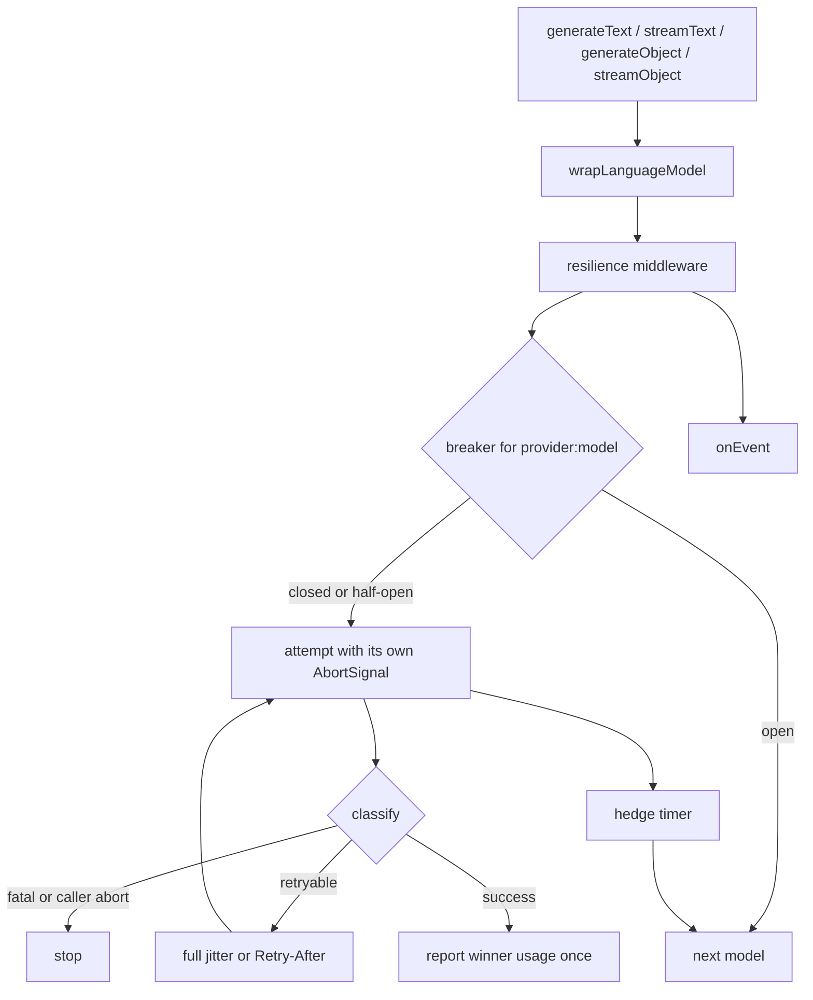
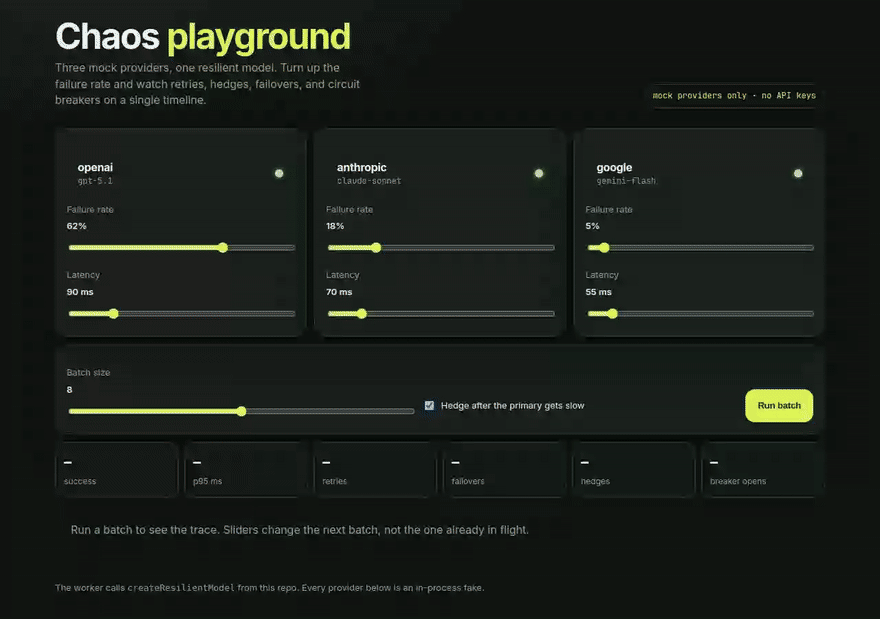

# ai-sdk-resilience

[](https://github.com/kfairy9999/ai-sdk-resilience/actions/workflows/ci.yml)

**Live playground:** https://ai-sdk-resilience.kfairley9999.workers.dev

Retry, fall back, hedge, and trip a circuit breaker around any Vercel AI SDK model. One wrapped `LanguageModel` works with `generateText`, `streamText`, `generateObject`, and `streamObject`.

Provider outages are a normal Tuesday. The SDK still leaves failover to you. This middleware is that layer: per model, with backoff that respects `Retry-After`, and with stream and usage behavior written down instead of hoped for.

## The problem

[vercel/ai#2636](https://github.com/vercel/ai/issues/2636) has been open since August 2024 (66 thumbs-up). It asks for retry strategies and fallbacks. The [custom provider `fallbackProvider`](https://ai-sdk.dev/docs/reference/ai-sdk-core/custom-provider#fallback-provider) does not fall back when a request errors. A comment on the issue says so directly.

Outages are not hypothetical. [Nobody is saying why OpenAI and Anthropic had outages](https://news.ycombinator.com/item?id=49567594) (Hacker News, 207 points) is one of a long run of days where the application was fine and the model host was not.

[ai-fallback](https://github.com/remorses/ai-fallback) (about 180 stars) is the closest library. It walks an ordered model list and, on a stream error, starts the next model over. It does not back off, read `Retry-After`, track health, hedge a slow call, or keep billed tokens from being reported twice. General resilience libraries such as [cockatiel](https://github.com/connor4312/cockatiel) and opossum retry promises. They do not know what an AI SDK stream part is.

## Quickstart

```bash
npm install ai-sdk-resilience ai @ai-sdk/provider
```

Peer dependencies are `ai@^7` and `@ai-sdk/provider@^4`. Set the SDK's own `maxRetries: 0`. Otherwise the SDK wraps this middleware in a second retry loop.

```ts
import { generateText, streamText } from 'ai';
import { createResilientModel } from 'ai-sdk-resilience';

const model = createResilientModel({
  models: [primary, secondary, tertiary],
  retry: { maxAttempts: 3, initialDelayMs: 200, maxDelayMs: 10_000 },
  circuitBreaker: { failureThreshold: 5, openDurationMs: 30_000 },
  hedge: { enabled: true, delayMs: 800 },
  stream: { onError: 'restart' },
  onEvent: (event) => console.log(event.type, event),
});

const result = await generateText({
  model,
  prompt: 'Summarize the incident in one sentence.',
  maxRetries: 0,
});
```

`result.usage` is the winning attempt. Tokens observed on failed or cancelled attempts are not added to it. The sum across attempts, each counted once, is on `providerMetadata['ai-sdk-resilience'].billedUsage` and on the `usage` event. Do not add those two figures together.

## Configuration

| Option | Default | What it does |
| --- | --- | --- |
| `models` | required | Ordered list. A bare model, or `{ model, providerOptions }`. First is primary. |
| `retry.maxAttempts` | `3` | Tries per model, including the first. |
| `retry.initialDelayMs` | `200` | Base of the exponential cap. |
| `retry.maxDelayMs` | `10000` | Cap before full jitter. |
| `retry.multiplier` | `2` | Exponential base. |
| `retry.maxRetryAfterMs` | `30000` | Ceiling for a server-supplied wait. |
| `circuitBreaker.failureThreshold` | `5` | Consecutive retryable failures that open the breaker. |
| `circuitBreaker.successThreshold` | `1` | Successes in half-open required to close. |
| `circuitBreaker.openDurationMs` | `30000` | How long the breaker stays open before a probe. |
| `circuitBreaker.halfOpenMaxInFlight` | `1` | Probes allowed at once. Extra calls skip the model. |
| `circuitBreaker.countRateLimits` | `true` | When false, HTTP 429 retries but does not trip the breaker. |
| `hedge.enabled` | `false` | Off by default. A hedge can be billed by the provider even though we report the winner. |
| `hedge.delayMs` | `800` | Wait before the next healthy model starts. Also the fallback until a percentile has enough samples. |
| `hedge.percentile` | unset | When set, the delay tracks that rolling percentile of successful latencies for the primary. |
| `hedge.minSamples` | `8` | Samples required before the percentile replaces `delayMs`. |
| `hedge.minMs` / `maxMs` | `50` / `10000` | Clamp on the hedge delay. |
| `stream.onError` | `'restart'` | `'restart'` or `'continue'`. See below. |
| `timeoutMs` | unset | Per-attempt deadline. The abort is retryable and is not a caller abort. |
| `classify` | built-in | `(error, fallback) => ErrorClass`. Return `fatal` to stop the whole call. |
| `onEvent` | unset | Telemetry. Exceptions from the hook are swallowed. |
| `clock` / `random` | system | Inject a clock or a `[0, 1)` source. Tests use both. |
| `registry` | per model | Share breakers and latency samples across wrappers. |

### What gets retried

Retryable: HTTP 408, 425, 429, 498, and any 5xx; timeouts; network failures (`ECONNRESET`, `fetch failed`, and the usual undici codes); a stream `error` part with a retryable cause.

Fatal, and never retried, including when a provider sets `isRetryable: true`: 400, 401, 402, 403, 404, 409, 413, 422, and the other client errors that are not 408 or 429. Prompt and schema validation errors from the SDK are fatal too. A caller `AbortSignal` stops the call and does not trip a breaker. A hedge that loses is cancelled, not failed.

Backoff is full jitter: a uniform draw in `[0, min(maxDelay, initial * multiplier^retry)]`. If `Retry-After`, `Retry-After-Ms`, `x-ratelimit-reset-requests`, `x-ratelimit-reset-tokens`, or the Anthropic reset headers parse to a longer wait, that wait is used, then capped by `maxRetryAfterMs`.

### Streams

`restart` (default) reads an attempt to completion and only then forwards it. A mid-stream error throws that buffer away and tries again. The caller sees one clean stream and one `finish` part. Time to first token is the time until an attempt succeeds.

`continue` forwards the partial text and sends the next attempt a prompt that ends with that assistant text plus an instruction not to repeat it. Tool-call streams are not resumed; a partial tool call is discarded and the next attempt starts clean. Continuation can drift or repeat. The provider may have billed the partial generation. `result.usage` is still only the attempt that finished.

### Circuit breaker

State is `closed`, `open`, or `half-open`, keyed by `provider:modelId`. Validation errors and hedge cancellations do not count. An open model is skipped. When every model is open the call throws `ResilienceError` with code `all-circuits-open`. After `openDurationMs` the next call is a probe. `successThreshold` successes close it. One probe failure opens it again.

State lives in memory on the registry. Two isolates do not share it. See limitations.

## Comparison

Same mock providers, 60 sequential `generateText` calls, seed `20261118`, measured 2026-11-18 on Node v22.23.4. Requests 24–31 are a forced primary HTTP 500. Full notes and the raw JSON are in [`bench/RESULTS.md`](bench/RESULTS.md). Re-run with `npm run bench`. Timers are real, so a re-run moves these by a few milliseconds.

| | Plain SDK | ai-fallback 3 | cockatiel | ai-sdk-resilience |
| --- | ---: | ---: | ---: | ---: |
| Success | 50.0% | 100% | 40.0% | 100% |
| p50 | 10.4 ms | 22.2 ms | 18.8 ms | 17.7 ms |
| p95 | 49.0 ms | 59.6 ms | 48.5 ms | 37.7 ms |
| p99 | 49.8 ms | 61.7 ms | 55.9 ms | 41.4 ms |

| Capability | ai-sdk-resilience | ai-fallback | cockatiel |
| --- | --- | --- | --- |
| Ordered model fallback | yes | yes | no |
| Exponential backoff with full jitter | yes | no | yes |
| `Retry-After` and provider reset headers | yes | no | no |
| Per-model circuit breaker | yes | no | breaker, not per model |
| Hedge on a latency threshold | yes | no | no |
| Stream restart without a second `finish` | yes | concatenates the next stream | no |
| Continue from partial text | yes | no | no |
| `result.usage` is the winner only | yes | not when streams are concatenated | n/a |

Cockatiel's 40% is lower than the plain SDK's 50% on purpose. The policy only wraps the primary. After the injected outage the breaker stays open and rejects calls the plain model would have served. That is what a breaker does when nothing is standing behind it. ai-fallback reaches 100% by switching models immediately, and it pays for that on the slow path: p95 is 59.6 ms against 37.7 ms here, where a hedge cuts off the slow primary and the breaker skips it once it is actually down.

## Architecture



`wrapGenerate` and `wrapStream` do not call the closed-over `doGenerate()`. That function is bound to the original params, so it cannot take a new `AbortSignal` per attempt. Each attempt calls the selected model's `doGenerate` or `doStream` with its own signal. The wrapper is still the AI SDK middleware entry point, which is what `generateText` and the streaming helpers call.

## Chaos playground



Mock providers only. Sliders set failure rate and latency. A batch draws a timeline of retries, failovers, hedges, and breaker transitions.

```bash
npm run playground
```

Then open http://127.0.0.1:4391.

### Live demo

**https://ai-sdk-resilience.kfairley9999.workers.dev** (Cloudflare Workers free tier). Mock providers only. The playground does not accept API keys, and nothing in the Worker uses a paid binding or a secret. CI runs `wrangler deploy --dry-run` and does not deploy. The package is not published to npm.

## Limitations

- Breaker and latency state are in-process. Serverless isolates and multiple Workers each learn an outage on their own. There is no shared store.
- A hedged or retried call can still be billed by the provider if they ignore `AbortSignal`. `result.usage` does not include that spend. `billedUsage` includes it only when the attempt returned a usage object before it was abandoned. Those are not the same number.
- `continue` can drift, and it does not resume a partial tool call.
- `restart` holds tokens until the attempt finishes, so time to first token waits on success.
- `Retry-After` longer than `maxRetryAfterMs` is capped. The default ceiling is 30 seconds.
- HTTP 401 and 403 are fatal. A bad key does not fail over to the next provider. ai-fallback will retry those. Change that with `classify` if you mean to.
- The AI SDK's `maxRetries` defaults to 2. Leave it at 0 when you use this middleware.
- `generateObject` and `streamObject` still work and are deprecated in AI SDK 7 in favor of `generateText` / `streamText` with `output`.
- The benchmark is one machine and mock models. It is not a measurement of OpenAI or Anthropic.

## Roadmap

- A registry adapter for Durable Objects or Redis so breakers are shared across isolates.
- Switch before the 429, using remaining-request headers rather than only the reset delay after the error.
- A commit threshold for streams so the caller can see tokens before the attempt is declared successful, without stitching two providers' output.
- An OpenTelemetry exporter next to `onEvent`.

## Develop

```bash
npm install
npm test
npm run test:coverage
npm run bench
npm run playground
```

Node 20 and 22 run lint, typecheck, tests with coverage, the build, and the playground typecheck in CI. `wrangler deploy --dry-run` runs on Node 22 only; current Wrangler requires Node 22.12 or newer. AI SDK 7 declares `engines.node >= 22`. The library itself is ES2022 and is tested on Node 20 and 22.

## How it was built

Designed and directed by Kevin Fairley, built with AI coding agents.

## License

MIT. See [LICENSE](LICENSE).
